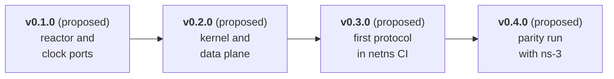

# Roadmap

The plan in one page: which release each piece of work serves, and what each
release must show to ship. The org-wide view is the
[org ROADMAP](https://github.com/swarm-routing/.github/blob/main/ROADMAP.md);
the shape follows
[swarm-adapter-ns3's roadmap](https://github.com/swarm-routing/swarm-adapter-ns3/blob/main/docs/roadmap.md).

**Deferred.** The daemon is planned later, not scheduled (org ROADMAP
decision 23): its epic #3 and children start when the maintainer re-plans
them. Until then no issue carries a `release:` label, and no release is cut.
The ladder below is the proposal that re-planning starts from; the
maintainer adopts or changes it.

## How this plan is tracked

Each issue a release gates will carry a `release:vX.Y.Z` label once the
maintainer adopts the ladder, so each column is a live query. All epics:
[`epic`](https://github.com/swarm-routing/swarm-routingd/issues?q=is%3Aopen+label%3Aepic).

## Release ladder

## Exit criteria

| Release | Theme | Must show to ship |
|---------|-------|-------------------|
| v0.1.0 | reactor and clock ports | the single-threaded `epoll` reactor with `timerfd` (`IClock`, `ITimerScheduler`) and `signalfd`; swarm-core consumed through vcpkg with `swarm-core.lock` verified; unit tests; the threat model current |
| v0.2.0 | kernel and data plane | `RtNetlinkSync` (`RTPROT_SWARM = 88`, `RTA_MULTIPATH` weights) carrying out `RouteDecision`s; the `swarm0` TUN catch-all with a bounded `PendingPacketQueue`; the dual-stack UDP control socket; route flush on `SIGINT`/`SIGTERM`; the kernel behaviours of swarm-routing/.github#548 checked |
| v0.3.0 | first protocol in netns CI | one protocol core (AntHocNet or HOPNET) by release lock through the compile-time `ProtocolRegistry`; a 3–5 node `netns` + `veth` integration test in CI; runs with `CAP_NET_ADMIN` only |
| v0.4.0 | parity run | the first end-to-end parity run against ns-3 in `benchmarks` (epic #3's last item); Shadow runs it unmodified |
| v1.0.0 | stable | the command line and config file frozen; packages and a service unit (swarm-routing/.github#267) |

## Non-goals

- No routing logic here: the cores decide, the daemon carries out (golden rule 10).
- No authentication of control messages in v0.x (docs/threat-model.md).
- No numbers published from CORE/EMANE runs: wall clock, not deterministic (epic #3).
